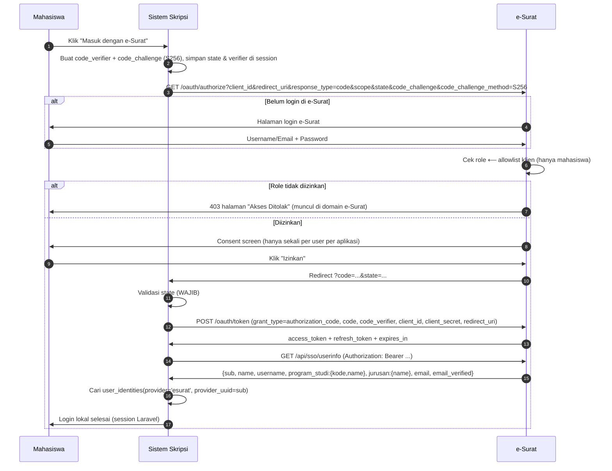

# Panduan Integrasi Klien SSO: Sistem Bimbingan Skripsi (Laravel 13)

> **Untuk siapa dokumen ini:** AI coding agent atau developer yang mengerjakan **repo Sistem Bimbingan Skripsi** (repo terpisah dari e-Surat).
>
> **Baca dokumen ini sampai habis sebelum menulis kode.** Isinya bukan saran opsional — beberapa aturan di sini mencegah bug yang mahal (akun ganda, data terbelah, privilege escalation).
>
> Dokumen sisi server (Identity Provider) ada di [`docs/SSO_MAHASISWA_OAUTH.md`](./SSO_MAHASISWA_OAUTH.md). Baca itu juga bila perlu memahami kontrak dari sisi e-Surat.

---

## 0. Ringkasan Satu Paragraf

Sistem Skripsi memakai **e-Surat FKIP sebagai Identity Provider** untuk **mahasiswa saja**. Dosen, staf, kaprodi, dan admin memakai **akun lokal** di Sistem Skripsi. SSO memakai OAuth2 **Authorization Code Grant + PKCE (S256)**. SSO **hanya** membuktikan identitas lewat UUID (`sub`) dan mengirim snapshot data mahasiswa sekali saat provisioning. **Tidak ada sinkronisasi dua arah.** Data akademik (judul TA, pembimbing, nilai) sepenuhnya milik Sistem Skripsi.

---

## 1. Batas Tanggung Jawab (WAJIB DIPATUHI)

| Data | Pemilik | Catatan |
|---|---|---|
| UUID identitas (`sub`) | e-Surat | **beku**, tidak pernah berubah |
| Password mahasiswa | e-Surat | **tidak pernah** disimpan di Sistem Skripsi |
| Nama, NPM, email mahasiswa | e-Surat → disalin **sekali** saat provisioning | setelah itu milik Sistem Skripsi |
| Kode program studi | e-Surat (sebagai `kode`, mis. `A1L0`) | dipetakan ke `prodi` lokal |
| Angkatan, konsentrasi, kontak | Sistem Skripsi | diisi mahasiswa saat onboarding |
| Role lokal (dosen/kaprodi/admin) | Sistem Skripsi | **tidak pernah** diwarisi dari `role_id` e-Surat |
| Jabatan struktural (kaprodi periode) | Sistem Skripsi | tabel `jabatan_struktural` |
| Data TA & bimbingan | Sistem Skripsi | |

### Aturan keras

1. **JANGAN** menyimpan password mahasiswa di Sistem Skripsi. Akun SSO punya `password = NULL`.
2. **JANGAN** auto-provision dosen/staf/kaprodi dari SSO. Hanya **mahasiswa**.
3. **JANGAN** menautkan akun otomatis berdasarkan email. Email di e-Surat **nullable dan tidak diverifikasi ketat**. Kunci tautan satu-satunya adalah `sub` (UUID).
4. **JANGAN** memetakan `role_id` e-Surat ke role lokal. `role_id` hanya gerbang izin masuk di sisi e-Surat.
5. **JANGAN** menulis data apa pun ke e-Surat. Integrasi bersifat **baca saja**.
6. **JANGAN** mengaktifkan ulang akun yang dinonaktifkan admin Sistem Skripsi hanya karena login SSO berhasil. `is_active` lokal **menang mutlak**.

---

## 2. Alur End-to-End



---

## 3. Prasyarat & Versi

| Komponen | Versi | Catatan |
|---|---|---|
| PHP | **8.3+** | Laravel 13 mensyaratkan `^8.3` |
| Laravel | **13.x** | direkomendasikan |
| `laravel/socialite` | `^5.31` | mendukung Laravel 13 |
| `socialiteproviders/laravelpassport` | `^4.3` | provider Passport untuk Socialite |
| `spatie/laravel-permission` | `^8.3` | RBAC lokal (butuh Laravel 12/13) |

> **Alternatif tanpa Socialite:** `league/oauth2-client` `^2.9` dengan provider custom (~60 baris). PKCE didukung native via `setPkceCode()` / `getPkceCode()`. Pilih salah satu, **jangan keduanya**.

```bash
composer require laravel/socialite:^5.31 \
                 socialiteproviders/laravelpassport:^4.3 \
                 spatie/laravel-permission:^8.3
```

---

## 4. Konfigurasi Environment

> **Bertahap, jangan langsung production.** Saat mengembangkan Sistem Skripsi, arahkan ke **e-Surat staging** (`https://staging-esurat.fkipunib.my.id`). Pindah ke production hanya setelah aplikasi siap rilis. Detail tangga rollout ada di [`docs/SSO_MAHASISWA_OAUTH.md`](./SSO_MAHASISWA_OAUTH.md) §13.

```env
# .env (Sistem Skripsi) — DEVELOPMENT, arahkan ke staging
APP_URL=http://localhost:8001

ESURAT_BASE_URL=https://staging-esurat.fkipunib.my.id
ESURAT_CLIENT_ID=<dari klien "Sistem Bimbingan Skripsi (Local Dev)">
ESURAT_CLIENT_SECRET=<secret pasangannya>
ESURAT_REDIRECT_URI=http://localhost:8001/auth/esurat/callback
```

```env
# .env (Sistem Skripsi) — PRODUCTION, baru dipakai saat rilis
APP_URL=https://eskripsi.fkip.unib.ac.id

ESURAT_BASE_URL=https://esurat.fkip.unib.ac.id
ESURAT_CLIENT_ID=<dari klien "Sistem Bimbingan Skripsi (Production)">
ESURAT_CLIENT_SECRET=<secret pasangannya>
ESURAT_REDIRECT_URI=https://eskripsi.fkip.unib.ac.id/auth/esurat/callback
```

> **Satu environment = satu klien OAuth = satu secret.** Jangan memakai klien staging untuk production, atau sebaliknya.
>
> **Redirect URI harus cocok PERSIS** dengan yang didaftarkan di e-Surat (skema, host, path, tanpa trailing slash). Perbedaan satu karakter → `invalid_client` / `invalid_grant`.
>
> `http://localhost:8001` tidak akan diterima oleh klien staging yang redirect-nya `https://staging-skripsi...`. Karena itu, untuk pengembangan lokal mintalah admin e-Surat membuat klien khusus **"Sistem Bimbingan Skripsi (Local Dev)"** dengan redirect `http://localhost:8001/auth/esurat/callback`. Jangan mengubah klien staging hanya untuk keperluan lokal.
>
> Secret diberikan **sekali** saat admin membuat klien di Filament e-Surat atau menjalankan `php artisan db:seed --class=SsoClientSeeder`. Tidak bisa dilihat lagi (di-hash). Bila hilang, minta admin menekan **Regenerate Secret** (secret lama langsung mati).

```php
// config/services.php
'esurat' => [
    'client_id' => env('ESURAT_CLIENT_ID'),
    'client_secret' => env('ESURAT_CLIENT_SECRET'),
    'redirect' => env('ESURAT_REDIRECT_URI'),
    'base_url' => env('ESURAT_BASE_URL'),
],
```

---

## 5. Skema Database Lokal

```php
// users
$table->id();
$table->string('name');
$table->string('email')->nullable()->unique();
$table->string('nim')->nullable()->unique();        // khusus mahasiswa
$table->string('password')->nullable();             // NULL = SSO-only
$table->boolean('is_active')->default(true);
$table->timestamp('email_verified_at')->nullable();
$table->timestamps();
$table->softDeletes();

// user_identities  ← INTI, jangan digabung ke tabel users
$table->id();
$table->foreignId('user_id')->constrained()->cascadeOnDelete();
$table->string('provider', 30);                     // 'esurat'
$table->string('provider_uuid', 64);                // = users.id e-Surat (UUID)
$table->timestamp('linked_at')->nullable();
$table->timestamp('last_synced_at')->nullable();
$table->unique(['provider', 'provider_uuid']);
$table->unique(['provider', 'user_id']);

// mahasiswa (profil akademik, terpisah dari users)
$table->id();
$table->foreignId('user_id')->unique()->constrained()->cascadeOnDelete();
$table->string('nim')->unique();
$table->string('nama');
$table->foreignId('prodi_id')->nullable()->constrained('prodi');
$table->year('angkatan')->nullable();
$table->string('konsentrasi')->nullable();
$table->string('kontak')->nullable();
$table->boolean('profil_lengkap')->default(false);
```

> **Kenapa `user_identities` dipisah:** saat nanti ada IdP lain (mis. SSO Fakultas Teknik), cukup tambah baris `provider`, tanpa migrasi tabel `users`.

---

## 6. Implementasi Provider Socialite

### 6.1 Registrasi provider

```php
// app/Providers/AppServiceProvider.php  (Laravel 13 — atau bootstrap/providers.php)
use Illuminate\Support\Facades\Event;
use SocialiteProviders\Manager\SocialiteWasCalled;

public function boot(): void
{
    Event::listen(function (SocialiteWasCalled $event) {
        $event->extendSocialite('laravelpassport', \SocialiteProviders\LaravelPassport\Provider::class);
    });
}
```

### 6.2 Provider custom (bila memakai `league/oauth2-client`)

```php
namespace App\Services\Sso;

use League\OAuth2\Client\Provider\GenericProvider;
use League\OAuth2\Client\Provider\ResourceOwnerInterface;

class EsuratProvider extends GenericProvider
{
    // PKCE wajib aktif
    protected function getPkceMethod(): string
    {
        return static::PKCE_METHOD_S256;
    }
}
```

---

## 7. Controller

```php
namespace App\Http\Controllers\Auth;

use App\Http\Controllers\Controller;
use App\Models\Mahasiswa;
use App\Models\Prodi;
use App\Models\User;
use App\Models\UserIdentity;
use Illuminate\Http\Request;
use Illuminate\Support\Facades\Auth;
use Illuminate\Support\Facades\DB;
use Illuminate\Support\Str;
use Laravel\Socialite\Facades\Socialite;

class EsuratController extends Controller
{
    /** Langkah 1: arahkan mahasiswa ke e-Surat. */
    public function redirect(Request $request)
    {
        return Socialite::driver('laravelpassport')
            ->scopes(['profile', 'email'])
            ->with(['state' => Str::random(40)])
            ->redirect();
    }

    /** Langkah 2: terima callback, validasi state, tukar code, provisioning. */
    public function callback(Request $request)
    {
        // Socialite memvalidasi state secara internal. Jangan matikan itu.
        $remote = Socialite::driver('laravelpassport')->user();

        $sub = (string) $remote->getId();          // = users.id e-Surat (UUID)
        abort_if(blank($sub), 403, 'Identitas dari e-Surat tidak valid.');

        if ($existing = UserIdentity::where('provider', 'esurat')
                ->where('provider_uuid', $sub)->first()) {
            return $this->loginExisting($existing);
        }

        return $this->provision($remote, $sub);
    }

    protected function loginExisting(UserIdentity $identity)
    {
        $user = $identity->user;

        // Status lokal MENANG. Jangan reaktivasi otomatis.
        if (! $user || ! $user->is_active || $user->trashed()) {
            return redirect()->route('login')
                ->withErrors(['sso' => 'Akun Anda dinonaktifkan. Hubungi admin fakultas.']);
        }

        $identity->forceFill(['last_synced_at' => now()])->save();

        Auth::login($user, remember: true);
        request()->session()->regenerate();

        return redirect()->intended($user->homeUrl());
    }

    protected function provision($remote, string $sub)
    {
        $nim = (string) ($remote->user['username'] ?? '');

        // NIM belum ada → buat akun baru.
        // NIM SUDAH ada → JANGAN buat akun kedua, antre admin.
        if ($nim && Mahasiswa::where('nim', $nim)->exists()) {
            return redirect()->route('login')->withErrors([
                'sso' => 'NIM Anda sudah terdaftar dengan akun lokal. Hubungi admin untuk menautkan akun.',
            ]);
        }

        $kodeProdi = $remote->user['program_studi']['kode'] ?? null;
        $prodi = $kodeProdi ? Prodi::where('kode', $kodeProdi)->first() : null;

        $user = DB::transaction(function () use ($remote, $sub, $nim, $prodi) {
            $user = User::create([
                'name' => $remote->getName() ?: ($nim ?: 'Mahasiswa'),
                'email' => $remote->getEmail(),          // boleh null
                'nim' => $nim ?: null,
                'password' => null,                      // SSO-only
                'is_active' => true,
                'email_verified_at' => now(),            // dipercaya dari IdP
            ]);

            $user->assignRole('mahasiswa');              // role terendah, TIDAK dari e-Surat

            Mahasiswa::create([
                'user_id' => $user->id,
                'nim' => $nim ?: '',
                'nama' => $user->name,
                'prodi_id' => $prodi?->id,               // null bila kode tidak cocok
                'profil_lengkap' => false,
            ]);

            UserIdentity::create([
                'user_id' => $user->id,
                'provider' => 'esurat',
                'provider_uuid' => $sub,
                'linked_at' => now(),
                'last_synced_at' => now(),
            ]);

            return $user;
        });

        Auth::login($user);
        request()->session()->regenerate();

        return redirect()->route('mahasiswa.onboarding');
    }
}
```

---

## 8. Aturan Provisioning (tabel keputusan)

| Kondisi saat login SSO | Tindakan |
|---|---|
| `identity(uuid)` ada & `is_active` | Masuk akun itu |
| `identity(uuid)` ada & `!is_active` / soft-deleted | **Tolak**, jangan reaktivasi |
| Tidak ada identity, NIM belum terpakai | Buat `users` (`password=NULL`, role `mahasiswa`) + `mahasiswa` + `user_identities` |
| Tidak ada identity, NIM **sudah** terpakai | **Tolak**, arahkan hubungi admin (cegah duplikasi) |
| `kode` prodi tidak ada di master lokal | Buat user dengan `prodi_id = NULL`, `profil_lengkap = false`; **login tetap boleh** |
| Client SSO sedangkan pengguna adalah dosen/staf | Tidak relevan — mereka tidak punya akun e-Surat dengan role mahasiswa |

> **Prodi tidak boleh dipilih bebas oleh mahasiswa.** Prodi menentukan kaprodi mana yang berhak ACC judul. Jika auto-map gagal, hanya admin yang boleh mengisi.

---

## 9. Halaman Login (satu halaman, dua metode)

```
┌──────────────────────────────────────────────┐
│   Sistem Bimbingan Skripsi FKIP              │
│                                              │
│   ┌────────────────────────────────────────┐ │
│   │  Masuk dengan e-Surat (khusus mhs)     │ │  ← primary
│   └────────────────────────────────────────┘ │
│                                              │
│   ─────────────────  atau  ─────────────────  │
│                                              │
│   Untuk dosen, staf, dan admin               │
│   NIP / Email                                │
│   [____________________________________]     │
│   Password                                   │
│   [____________________________________]     │
│   [                Masuk                ]    │
│                                              │
│   Belum punya akun? Daftar di e-Surat ↗      │
└──────────────────────────────────────────────┘
```

Aturan:
- **Tidak ada pemilih role.** Label audiens yang memandu.
- **Tidak ada form register.** Tautan ke `/register` e-Surat (tab baru, `target="_blank" rel="noopener"`).
- Tombol SSO **selalu tampil**. Penyaringan role terjadi di e-Surat.

### Pesan error yang wajib spesifik

| Kasus | Pesan (JANGAN "password salah") |
|---|---|
| Mahasiswa login lewat form lokal (`password = NULL`) | "Akun mahasiswa menggunakan e-Surat. Klik tombol **Masuk dengan e-Surat**." |
| Akun dinonaktifkan | "Akun Anda dinonaktifkan. Hubungi admin fakultas." |
| NIM sudah terdaftar | "NIM Anda sudah terdaftar. Hubungi admin untuk menautkan akun." |
| e-Surat tidak dapat dihubungi | "Layanan e-Surat sedang tidak dapat diakses. Coba lagi atau hubungi admin." |

```php
// LoginController: deteksi akun SSO-only
if ($user && is_null($user->password)) {
    throw ValidationException::withMessages([
        'email' => 'Akun mahasiswa menggunakan e-Surat. Klik tombol "Masuk dengan e-Surat".',
    ]);
}
```

---

## 10. Onboarding Profile (progressive profiling)

Setelah provisioning, mahasiswa diarahkan ke halaman pelengkapan:

| Field | Diisi |
|---|---|
| Nama, NPM, email | sudah dari SSO (read-only) |
| Prodi | read-only bila sudah terisi; bila `NULL` → tampil "hubungi admin" |
| Angkatan | mahasiswa (dropdown tahun) |
| Konsentrasi | mahasiswa (dropdown, difilter per prodi) |
| No. HP | mahasiswa |
| Dosen PA | admin |

Set `profil_lengkap = true` hanya jika field wajib terisi **dan** `prodi_id` tidak null.

---

## 11. Sinkronisasi (hanya manual)

| Skenario | Perilaku default | Aksi admin |
|---|---|---|
| Mahasiswa ganti nama di e-Surat | **Tidak** berubah di Sistem Skripsi | Tombol "Refresh dari e-Surat" (manual) |
| Mahasiswa ganti prodi | **Tidak** berubah | Admin ubah manual (prodi butuh validasi) |
| Admin ubah jabatan kaprodi | Tidak berdampak ke e-Surat | — |
| Akun e-Surat dihapus | Tautan jadi yatim | Job pembersih menandai `orphaned_at`; **jangan** auto-hapus |
| Admin nonaktifkan akun | Login SSO ditolak | — |

**Tidak ada** sync otomatis, cron, atau webhook. Alasan: e-Surat bukan otoritas data akademik; dua arah = distributed transaction tanpa pemenang.

---

## 12. RBAC Lokal (spatie/laravel-permission)

Role awal yang disarankan:

```
mahasiswa        → lihat TA sendiri, ajukan judul, bimbingan
dosen            → bimbing TA, setujui judul (sebagai pembimbing)
kaprodi          → ACC judul tingkat prodi (butuh jabatan_struktural aktif)
operator-prodi   → kelola data mahasiswa prodi
admin-fakultas   → kelola semua
super-admin      → konfigurasi sistem
penguji          → beri nilai (dikaitkan ke pivot penguji_ta)
bendahara        → honor/keuangan (jika ada)
```

**Jabatan struktural bukan role.** Simpan di tabel terpisah:

```php
// jabatan_struktural
$table->foreignId('dosen_id')->constrained('dosen');
$table->string('jabatan');            // kaprodi, sekprodi, ...
$table->foreignId('prodi_id')->constrained('prodi');
$table->date('mulai');
$table->date('selesai')->nullable();
```

Izin diperiksa saat request, bukan dari role:

```php
$bolehAcc = JabatanStruktural::where('dosen_id', $user->dosen_id)
    ->where('jabatan', 'kaprodi')
    ->where('prodi_id', $ta->prodi_id)
    ->where('mulai', '<=', now())
    ->where(fn ($q) => $q->whereNull('selesai')->orWhere('selesai', '>=', now()))
    ->exists();
```

### Pembimbing & penguji = pivot per TA, bukan role

```php
// pembimbing_ta
$table->foreignId('ta_id')->constrained('tugas_akhir');
$table->foreignId('dosen_id')->constrained('dosen');
$table->enum('peran', ['utama', 'pendamping']);
$table->date('mulai')->nullable();
$table->date('selesai')->nullable();

// penguji_ta
$table->foreignId('ta_id')->constrained('tugas_akhir');
$table->foreignId('dosen_id')->constrained('dosen');
$table->enum('peran', ['ketua', 'anggota']);
```

Satu dosen bisa **pembimbing TA si A** sekaligus **penguji TA si B**. Karena itu "pembimbing" tidak boleh menjadi role.

---

## 13. Master Dosen (milik Sistem Skripsi, bukan e-Surat)

e-Surat **tidak punya role dosen** dan tidak menyimpan NIDN, bidang keahlian, kuota bimbingan, atau jabatan fungsional. Semua itu milik Sistem Skripsi.

```php
// dosen
$table->id();
$table->foreignId('user_id')->nullable()->unique()->constrained(); // null = belum punya akun
$table->string('nidn')->nullable()->unique();
$table->string('nama');
$table->foreignId('prodi_id')->nullable()->constrained('prodi');
$table->string('bidang_keahlian')->nullable();
$table->unsignedTinyInteger('kuota_bimbingan')->default(0);
$table->string('jabatan_fungsional')->nullable();
$table->boolean('is_eksternal')->default(false);
$table->boolean('is_active')->default(true);
```

- **Akun dosen dibuat admin** (import CSV/Excel + email reset password). Boleh `user_id = NULL` jika dosen hanya dicatat sebagai data (mis. penguji eksternal).
- Assignment pembimbing/penguji menunjuk ke `dosen.id`, **bukan** `users.id` — sehingga dosen tanpa akun tetap bisa di-assign.

---

## 14. Refresh Token

| Hal | Nilai |
|---|---|
| `access_token` | berlaku 1 jam |
| `refresh_token` | berlaku 30 hari |
| Simpan di mana | **Jangan** di session Laravel. Simpan terenkripsi di `user_identities.refresh_token` **hanya bila** Sistem Skripsi perlu memanggil API e-Surat lagi |
| Bila tidak perlu apa pun setelah login | **Jangan simpan** token sama sekali |

```php
// Hanya jika perlu memanggil userinfo lagi nanti
$identity->update(['refresh_token' => encrypt($token['refresh_token'])]);
```

---

## 15. Logout

```php
public function logout(Request $request)
{
    $identity = $request->user()?->esuratIdentity;

    if ($identity?->access_token) {
        // Opsional: cabut token di e-Surat
        Http::withToken(decrypt($identity->access_token))
            ->post(config('services.esurat.base_url') . '/api/sso/logout');
    }

    Auth::logout();
    $request->session()->invalidate();
    $request->session()->regenerateToken();

    return redirect()->route('login');
}
```

**Single sign-out (logout e-Surat ikut mematikan sesi Sistem Skripsi) belum diimplementasi.** Jangan berjanji fitur ini.

---

## 16. Matriks Test yang Wajib Ada

| Test | Ekspektasi |
|---|---|
| Callback sukses, identity belum ada, NIM baru | user + mahasiswa + identity dibuat, role `mahasiswa`, login |
| Callback sukses, identity sudah ada | tidak ada duplikasi user, login |
| `state` tidak cocok | ditolak, tidak ada user dibuat |
| Callback tanpa `code` | ditolak |
| `code_verifier` salah | e-Surat mengembalikan 400, ditangani, tidak login |
| Identity ada tapi `is_active = false` | ditolak, pesan "dinonaktifkan", **tidak** reaktivasi |
| Identity ada tapi user soft-deleted | ditolak |
| NIM sudah dipakai akun lokal | ditolak, pesan "hubungi admin", tidak buat akun kedua |
| `kode` prodi tidak dikenal | user dibuat dengan `prodi_id = NULL`, login berhasil |
| Mahasiswa login lewat form lokal (`password=NULL`) | pesan "gunakan tombol e-Surat", bukan "password salah" |
| Dua login SSO berurutan | hanya satu baris `user_identities` |

Gunakan `Http::fake()` untuk memalsukan respons `/oauth/token` dan `/api/sso/userinfo`.

---

## 17. Kesalahan Umum (anti-pattern)

| ❌ Salah | ✅ Benar |
|---|---|
| Menyimpan password e-Surat | `password = NULL`, hanya token |
| Auto-link berdasarkan email | Link hanya via `sub` (UUID) atau admin |
| Auto-provision semua role | Hanya `mahasiswa`; sisanya lokal |
| `role_id` e-Surat → role lokal | Abaikan; role lokal ditentukan admin |
| Reaktivasi akun saat login SSO | Tolak jika `is_active = false` |
| Menghapus user lalu bikin baru saat login ulang | Soft delete + tombstone |
| Form register sendiri di Sistem Skripsi | Tautan ke `/register` e-Surat |
| Menyembunyikan tombol SSO dari dosen | Tombol selalu tampil; gate di e-Surat |
| Menyimpan `access_token` di session | Session Laravel cukup; token hanya bila perlu |
| Menganggap logout e-Surat = logout Sistem Skripsi | Tidak; belum ada back-channel logout |

---

## 18. Checklist Setup

- [ ] PHP 8.3+, Laravel 13 terpasang
- [ ] `laravel/socialite`, `socialiteproviders/laravelpassport`, `spatie/laravel-permission` terpasang
- [ ] Migrasi `user_identities`, `mahasiswa`, `dosen`, `prodi`, `jabatan_struktural`, `pembimbing_ta`, `penguji_ta` dibuat
- [ ] `config/services.php` berisi blok `esurat`
- [ ] `.env` berisi `ESURAT_*`; `APP_URL` HTTPS benar
- [ ] Admin e-Surat sudah membuat klien SSO, role **mahasiswa** dicentang, redirect URI disalin **persis**
- [ ] Seeder `prodi` memakai kode yang sama dengan e-Surat (`A1L0`, `A1A0`, …) — ada 22 kode di `ProgramStudiSeeder.php` e-Surat
- [ ] Route `GET /auth/esurat/redirect` dan `GET /auth/esurat/callback` terdaftar
- [ ] Tabel test §16 hijau
- [ ] Halaman login: tombol SSO + form lokal + tautan daftar
- [ ] Halaman onboarding profil dibuat
- [ ] Seeder role lokal dijalankan

### Verifikasi otomatis (dari sisi e-Surat)

Sebelum menyalahkan kode klien, pastikan Identity Provider-nya sehat. Jalankan dari repo e-Surat:

```bash
SSO_BASE_URL=https://staging-esurat.fkipunib.my.id \
SSO_CLIENT_ID=<id_klien> \
SSO_CLIENT_SECRET=<secret> \
SSO_REDIRECT_URI=<redirect_uri_klien> \
php scripts/sso-smoke.php
```

Kalau script ini lulus tetapi klien gagal, masalahnya ada di sisi klien (biasanya `redirect_uri` atau `state`/PKCE).

### Verifikasi manual

1. Klik "Masuk dengan e-Surat" → diarahkan ke **`staging-esurat.fkipunib.my.id`** (bukan production, bukan halaman palsu).
2. Login sebagai mahasiswa → consent muncul **sekali**; login berikutnya tanpa consent.
3. Login sebagai staf → halaman "Akses Ditolak" di **domain e-Surat**.
4. Setelah login, `users.password` = NULL, `user_identities.provider_uuid` = UUID.
5. Admin nonaktifkan akun → login SSO berikutnya ditolak.
6. Login dosen lewat form lokal → berhasil, tidak tersentuh SSO.
7. `ESURAT_BASE_URL` di `.env` **tidak** mengandung `esurat.fkip.unib.ac.id` selama masih tahap pengembangan.

---

## 19. Troubleshooting

| Gejala | Penyebab | Solusi |
|---|---|---|
| `invalid_client` | `client_id`/`secret` salah, atau klien di-revoke | Cek `.env`, cek menu SSO Clients di e-Surat |
| `invalid_grant` | `code` kadaluarsa (>10 menit) atau sudah dipakai | Ulangi alur dari awal |
| `invalid_request: code_verifier` | Verifier < 43 karakter atau tidak cocok | Pastikan PKCE S256 aktif dan verifier disimpan di session |
| `redirect_uri mismatch` | URI tidak sama persis | Samakan skema/host/path/trailing slash |
| `redirect_uri mismatch` saat dev lokal, staging normal | Memakai klien staging tapi `redirect` lokal | Mintakan klien **"Local Dev"** terpisah (§4) |
| Loop redirect / balik ke login terus | `APP_URL` e-Surat `http` padahal diakses `https`, atau proxy tidak dipercaya | Perbaiki `APP_URL` + `TrustProxies` di sisi e-Surat |
| `invalid_client` hanya di staging | `client_secret` production dipakai di staging | Tiap environment punya secret sendiri (§4) |
| 403 "Akses Ditolak" | Role user tidak ada di allowlist | Admin e-Surat centang role mahasiswa |
| Consent muncul terus | Token tidak tersimpan / scope berubah | Cek scope konsisten (`profile email`) |
| `cURL error 60` | Sertifikat SSL | Pastikan e-Surat pakai HTTPS valid |
| Mahasiswa dapat pesan "password salah" | Form lokal tidak mendeteksi `password = NULL` | Terapkan §9 pesan error spesifik |
| Data terbelah dua akun | Auto-provision tanpa cek NIM | Terapkan §8 |

---

## 20. Keputusan Arsitektur yang Sudah Dikunci

| # | Keputusan | Alasan |
|---|---|---|
| 1 | SSO **hanya mahasiswa** | Dosen tak ada di e-Surat; staf punya muscle memory username/password |
| 2 | Satu halaman login, dua metode | Menghindari pemilih role yang membingungkan |
| 3 | Tanpa form register lokal | Duplikasi total; register e-Surat sudah memvalidasi NPM + prefix prodi |
| 4 | Provisioning sekali, tanpa sync berkala | e-Surat bukan otoritas data akademik |
| 5 | `password = NULL` untuk akun SSO | Tidak ada password yang perlu dihafal/dibocorkan |
| 6 | Prodi auto dari `kode`; fallback admin | Prodi menentukan otorisasi ACC judul |
| 7 | Jabatan kaprodi = tabel periode | Rotasi jabatan tidak boleh merusak riwayat tanda tangan |
| 8 | Pembimbing/penguji = pivot per TA | Satu dosen bisa keduanya sekaligus |
