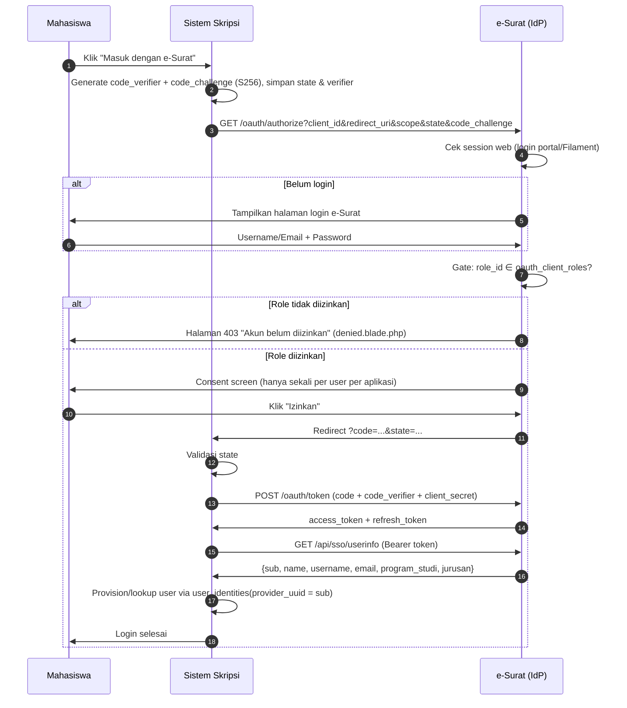
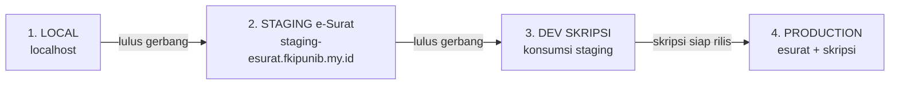

# SSO Mahasiswa: e-Surat FKIP sebagai Identity Provider (OAuth2 + PKCE)

Dokumen ini menjelaskan rancangan, arsitektur, dan panduan implementasi **Single Sign-On (SSO) khusus mahasiswa** menggunakan **Laravel Passport 12** pada aplikasi e-Surat FKIP. Aplikasi klien pertama adalah **Sistem Bimbingan Skripsi** (repo terpisah).

> **Dua dokumen, dua peran:**
> - Dokumen ini = **sisi server (Identity Provider)**.
> - **[`docs/SSO_CLIENT_INTEGRATION.md`](./SSO_CLIENT_INTEGRATION.md)** = **sisi klien** (Laravel 13). Berikan dokumen itu ke AI/developer yang mengerjakan repo Sistem Skripsi.


---

## 1. Ringkasan & Tujuan

**Tujuan:** Menghilangkan redundansi pendaftaran akun untuk mahasiswa. Mahasiswa yang sudah punya akun e-Surat dapat login ke Sistem Skripsi **tanpa membuat akun baru dan tanpa hafal password baru**.

**Bukan tujuan:**
- Sinkronisasi data akademik dua arah antara e-Surat dan Sistem Skripsi.
- SSO untuk dosen, staf, kaprodi, atau admin.
- Menjadikan e-Surat sumber master data mahasiswa/dosen.

### Batasan populasi (keputusan final)

| Populasi | Jalur login | Alasan |
|---|---|---|
| **Mahasiswa** | SSO (satu-satunya jalur) | Sudah punya akun e-Surat lewat self-register; jumlah besar; distribusi kredensial mahal |
| Dosen | Akun lokal Sistem Skripsi | e-Surat **tidak punya role "dosen"** sama sekali (role 1–22 tanpa dosen) |
| Staf prodi / Kaprodi | Akun lokal Sistem Skripsi | Muscle memory staff adalah username+password; SSO justru menambah kebingungan |
| Admin | Akun lokal Sistem Skripsi | *Privilege separation*: admin aplikasi baru tidak boleh lahir dari IdP |
| Penguji eksternal | Akun lokal Sistem Skripsi | Di luar ekosistem FKIP |

> **Prinsip emas:** *e-Surat sumber kebenaran untuk **siapa Anda**. Sistem Skripsi sumber kebenaran untuk **apa yang boleh Anda lakukan**.*

---

## 2. Arsitektur



### Pemisahan tanggung jawab

| Data | Pemilik tunggal | e-Surat | Sistem Skripsi |
|---|---|---|---|
| UUID identitas (`users.id`) | e-Surat | ✅ | simpan sebagai tautan beku |
| Password | e-Surat | ✅ | tidak pernah menyimpan (untuk akun SSO) |
| Nama mahasiswa | e-Surat (sekali saat provisioning) | ✅ sumber awal | ✅ setelah provisioning |
| NPM | e-Surat (sekali saat provisioning) | ✅ sumber awal | ✅ setelah provisioning |
| Email | e-Surat (sekali saat provisioning) | ✅ sumber awal | ✅ setelah provisioning |
| Prodi | e-Surat via `kode`; fallback admin | ⚠️ hanya `kode` | ✅ |
| Angkatan, konsentrasi, kontak | — | ❌ | ✅ |
| Jabatan struktural | — | ❌ | ✅ |
| Status aktif akun | — | ❌ | ✅ (`is_active` menang mutlak) |

**Nol sinkronisasi berkala.** Data mahasiswa disalin **sekali** saat provisioning, lalu menjadi milik Sistem Skripsi. Aksi "Refresh dari e-Surat" hanya manual oleh admin.

---

## 3. Kontrak API

### 3.1 Scopes

| Scope | Deskripsi | Wajib |
|---|---|---|
| `profile` | Nama, NPM, program studi, jurusan | ✅ |
| `email` | Alamat email | opsional |

### 3.2 `GET /api/sso/userinfo`

Guard: `auth:api` + `scope:profile`

```json
{
  "sub": "8f3a1b2c-...",
  "name": "Budi Santoso",
  "username": "A1L021001",
  "email": "budi@example.com",
  "program_studi": {
    "kode": "A1L0",
    "name": "S1 Bimbingan dan Konseling"
  },
  "jurusan": {
    "name": "Jurusan Ilmu Pendidikan"
  }
}
```

**Catatan penting:**
- `sub` = `users.id` (UUID) di e-Surat. **Bukan** NPM/username — kolom `username` di e-Surat **tidak unik** (rule `unique:users,username` dikomentari di `AuthController.php`).
- `program_studi` mengirim **`kode`** (A1L0, A1A0, dst), bukan `program_studi_id`. ID tersebut milik database e-Surat dan tidak bermakna di Sistem Skripsi.
- `role_id` dan `nip` **tidak dikirim**, karena populasi SSO hanya mahasiswa.

### 3.3 `POST /api/sso/logout`

Guard: `auth:api`. Revoke token aktif milik user.

---

## 4. Skema Database (e-Surat)

### 4.1 Tabel Passport

Dipublikasikan dari package (`vendor:publish --tag=passport-migrations`):

- `oauth_clients`
- `oauth_access_tokens`
- `oauth_auth_codes`
- `oauth_refresh_tokens`
- `oauth_personal_access_clients`

> ⚠️ **Wajib diubah:** `users.id` di proyek ini adalah **UUID**, sedangkan Passport 12 mendeklarasikan `user_id` sebagai `unsignedBigInteger`. Ubah dua baris sebelum `migrate`:
>
> ```php
> // oauth_access_tokens
> $table->uuid('user_id')->nullable()->index();
> // oauth_auth_codes
> $table->uuid('user_id')->index();
> ```

### 4.2 Kolom tambahan `oauth_clients`

| Kolom | Tipe | Default | Fungsi |
|---|---|---|---|
| `description` | text null | — | Deskripsi yang tampil di consent screen |
| `is_active` | boolean | `true` | Kill switch per aplikasi |
| `require_email_verified` | boolean | `true` | Gate verifikasi email per aplikasi |
| `scopes` | json null | — | Scope maksimal yang boleh diminta klien |
| `grant_types` | json null | — | Grant type yang diizinkan |

> Passport 12 sudah men-cast `scopes` dan `grant_types` di model `Client`, tetapi **tidak membuat kolomnya**. Tanpa kolom ini `hasScope()`/`hasGrantType()` selalu mengembalikan `true`. Menambahkannya adalah *hardening* gratis.

### 4.3 Tabel `oauth_client_roles` (allowlist dinamis)

```
oauth_client_roles
  id          bigint PK
  client_id   bigint  FK → oauth_clients.id  (cascadeOnDelete)
  role_id     bigint  FK → roles.id          (cascadeOnDelete)
  timestamps
  UNIQUE (client_id, role_id)
```

**Kenapa pivot, bukan kolom JSON `allowed_roles`:**
1. FK menjamin role yang dihapus otomatis hilang dari allowlist (JSON menyimpan ID hantu).
2. Bisa di-query/join untuk audit.
3. Filament `Select::multiple()->relationship()` langsung berfungsi tanpa cast manual.

**Deny by default:** allowlist kosong = tidak ada yang boleh masuk.

---

## 5. Alur Authorize (Gate)

```
GET /oauth/authorize?client_id&redirect_uri&scope&state&code_challenge
  │
  ├─ 1. client ada, is_active, tidak revoked?        → tidak: tolak OAuth
  ├─ 2. redirect_uri cocok persis?                    → tidak: tolak (anti open-redirect)
  ├─ 3. scope ⊆ client.scopes?                        → tidak: invalid_scope
  ├─ 4. session web ada?                              → tidak: AuthenticationException → halaman login
  ├─ 5. require_email_verified && email NULL?         → tolak (default OFF, lihat §11)
  ├─ 6. role_id ∈ oauth_client_roles?                 → tidak: halaman denied (403)
  ├─ 7. sudah punya token valid dgn scope sama?       → ya: approve langsung (consent dilewati)
  └─ 8. tampilkan consent screen
```

Poin 7 **sudah otomatis** di Passport (`AuthorizationController::hasValidToken`) — inilah yang mewujudkan "consent sekali per user per aplikasi" tanpa kode tambahan.

### Implementasi: binding container, bukan route override

Route Passport didaftarkan oleh **package service provider**, yang boot **sebelum** `RouteServiceProvider`. Menambah `/oauth/authorize` di `routes/web.php` akan **kalah prioritas**. Cara yang benar:

```php
// app/Providers/AppServiceProvider::register()
$this->app->bind(
    \Laravel\Passport\Http\Controllers\AuthorizationController::class,
    \App\Http\Controllers\Sso\AuthorizationController::class
);
```

### Revokasi saat allowlist berubah

Ketika admin menyimpan perubahan allowlist, revoke token milik klien tersebut untuk user yang tidak lagi diizinkan. Tanpa ini, refresh token tetap hidup hingga 30 hari.

---

## 6. UI Consent & Halaman Penolakan

### Consent screen
- Menampilkan: nama aplikasi, deskripsi, daftar data yang dibagikan (nama, NPM, email, prodi), identitas user yang sedang login.
- Tombol: **Izinkan** / **Batal**.
- Muncul **sekali** per user per aplikasi (lihat §5 poin 7).

### Halaman penolakan (`denied.blade.php`)
Pesan harus manusiawi dan **muncul di domain e-Surat** (Sistem Skripsi tidak pernah menerima token sehingga tidak tahu apa pun):

> "Akun Anda (role: staf) belum diizinkan mengakses **Sistem Bimbingan Skripsi**.
> Aplikasi ini khusus mahasiswa. Hubungi admin fakultas jika menurut Anda ini keliru."

---

## 7. Filament Admin

Resource baru `App\Filament\Resources\SsoClientResource`, grup navigasi **Developer Tools** (konsisten dengan `RoleResource` dan `JenisSuratResource`).

| Field | Tipe |
|---|---|
| Name | text, required |
| Description | textarea |
| Redirect URI | text, required (satu URI per klien) |
| Aktif | toggle |
| Wajib email terverifikasi | toggle |
| Role yang diizinkan | `Select::multiple()->relationship('roles')` ← **dinamis dari tabel roles** |
| Scope yang diizinkan | CheckboxList (`profile`, `email`) |

Aksi: **Regenerate Secret** dan **Revoke Client** (set `revoked = true` + revoke semua token, tanpa hapus baris).

> `client_secret` hanya ditampilkan **sekali** saat dibuat/di-regenerate, karena `Passport::hashClientSecrets()` aktif.

**Klien default:** `sistem-skripsi`, `roles = [2]`, `scopes = [profile, email]`, `require_email_verified = false`.

---

## 8. Konfigurasi e-Surat

### 8.1 Dependency

```bash
composer require laravel/passport:^12.4
```

> Passport **v13 tidak kompatibel** — ia mensyaratkan Laravel 11+. Proyek ini Laravel 10 dengan `config.platform.php = 8.2.0`.

### 8.2 Guard & trait

```php
// app/Models/User.php
use Laravel\Passport\HasApiTokens;   // ganti dari Laravel\Sanctum\HasApiTokens

// config/auth.php
'guards' => [
    'web' => ['driver' => 'session', 'provider' => 'users'],
    'api' => ['driver' => 'passport', 'provider' => 'users'],
],
```

### 8.3 `AuthServiceProvider::boot()`

```php
Passport::useClientModel(\App\Models\OAuthClient::class);
Passport::tokensCan([
    'profile' => 'Melihat identitas dasar (nama, NPM, program studi, jurusan)',
    'email'   => 'Melihat alamat email',
]);
Passport::tokensExpireIn(now()->addHour());
Passport::refreshTokensExpireIn(now()->addDays(30));
Passport::hashClientSecrets();
Passport::authorizationView('oauth.authorize');
```

### 8.4 Rute API

```php
// routes/api.php
Route::middleware('auth:api')->get('/user', fn (Request $r) => $r->user());
```

> Route ini sebelumnya memakai `auth:sanctum` dan **tidak dipakai oleh kode mana pun** (`createToken()` tidak pernah dipanggil). Migrasi ke Passport tidak berdampak pada fitur surat.

### 8.5 Environment

```env
# .env (production)
APP_URL=https://esurat.fkip.unib.ac.id   # WAJIB HTTPS & benar (memengaruhi state/redirect)
```

Generate key di server: `php artisan passport:keys`.

---

## 9. Sisi Sistem Skripsi (Repo Terpisah)

### 9.1 Halaman login (satu halaman, dua metode)

```
┌──────────────────────────────────────────────┐
│   Sistem Bimbingan Skripsi FKIP              │
│                                              │
│   ┌────────────────────────────────────────┐ │
│   │  Masuk dengan e-Surat (khusus mhs)     │ │  ← primary
│   └────────────────────────────────────────┘ │
│                                              │
│   ─────────────────  atau  ─────────────────  │
│                                              │
│   Untuk dosen, staf, dan admin               │
│   NIP / Email                                │
│   [____________________________________]     │
│   Password                                   │
│   [____________________________________]     │
│   [                Masuk                ]    │
│                                              │
│   Belum punya akun? Daftar di e-Surat ↗      │
└──────────────────────────────────────────────┘
```

- **Tidak ada pemilih role.** Label audiens yang memandu user.
- **Tidak ada form register.** Tautan menuju `/register` e-Surat (tab baru) — form tersebut sudah ada dan sudah memvalidasi NPM berprefix kode prodi FKIP, memaksa `role_id = 2`, dan mengirim email verifikasi (`AuthController::store`).

### 9.2 Skema lokal

```
users
  password       string nullable     -- NULL = SSO-only
  is_active      boolean default true
  softDeletes

user_identities
  user_id        FK users
  provider       string 'esurat'
  provider_uuid  string              -- = users.id e-Surat (UUID)
  linked_at
  last_synced_at
  UNIQUE (provider, provider_uuid)
  UNIQUE (provider, user_id)
```

### 9.3 Aturan provisioning

| Kondisi saat login SSO | Tindakan |
|---|---|
| `identity(uuid)` ditemukan & `is_active` | Masuk |
| `identity(uuid)` ditemukan & `!is_active` / soft-deleted | **Tolak**, jangan reaktivasi |
| Tidak ada identity, NIM belum ada | Buat `users` (password NULL, role mahasiswa) + `mahasiswa` |
| Tidak ada identity, NIM sudah ada | **Tolak**, antre admin (cegah duplikasi akun) |
| `kode` prodi tidak cocok | Buat user dengan `prodi = NULL`, flag "profil belum lengkap" (jangan blokir login) |

**Prodi tidak boleh dipilih bebas oleh mahasiswa** — prodi menentukan kaprodi mana yang berhak ACC judul. Jika auto-map gagal, hanya admin yang boleh mengisi.

### 9.4 Enforce server-side

Mahasiswa yang mencoba login lewat form lokal (`password = NULL`) **tidak boleh** mendapat pesan "password salah". Pesan yang benar:

> "Akun mahasiswa menggunakan e-Surat. Silakan klik tombol **Masuk dengan e-Surat**."

Ini mencegah mahasiswa terkunci karena mencoba 5 kali dengan password yang tidak pernah ada.

---

## 10. Testing

Pola: **`DatabaseTransactions`**, bukan `RefreshDatabase`.

**Alasan konkret:** `LegacySuratRegressionTest` dan 10 file test lain memakai `DatabaseTransactions` dan **mengandalkan data seed yang sudah ada** (`User::where('role_id', ...)->first()`). `RefreshDatabase` akan `migrate:fresh` DB `testing` sehingga kelas test berikutnya kehilangan seed.

Key Passport tidak boleh bergantung pada `storage/*.key` (gitignored). Simpan fixture key di `tests/fixtures/passport/` dan panggil `Passport::loadKeysFrom()` di `setUp()`.

### Cakupan `tests/Feature/SsoMahasiswaTest.php`

- role 2 → consent 200
- role 3/4/8 → denied 403
- allowlist kosong → tolak
- client `is_active = false` / `revoked` → tolak
- `redirect_uri` tidak cocok → tolak
- scope di luar `client.scopes` → `invalid_scope`
- PKCE: verifier benar → 200; salah → 400
- `userinfo`: tanpa token 401; scope kurang 403; `sub` = UUID
- cabut role dari pivot → token lama tidak bisa akses `userinfo`
- regresi: `LegacySuratRegressionTest`, `BendaharaFilamentResourceTest` tetap hijau

---

## 11. Keputusan yang Sudah Dikunci

| # | Keputusan | Alasan |
|---|---|---|
| 1 | SSO **hanya mahasiswa** | Staff punya muscle memory username/password; tombol dengan dua populasi membuat ambigu |
| 2 | Allowlist **dinamis di DB** (isinya `[2]`) | Fleksibel ke depan tanpa deploy; biaya satu tabel pivot |
| 3 | `require_email_verified = false` | Hemat kuota SMTP; SSO **tidak mengirim email** sama sekali. Konsekuensi: email **tidak boleh** jadi identifier — kunci tautan tetap UUID |
| 4 | Nol sinkronisasi data dua arah | e-Surat bukan otoritas data akademik; dua arah = distributed transaction tanpa pemenang |
| 5 | `role_id` e-Surat **tidak** dipakai untuk assign role lokal | Jabatan punya periode; privilege separation |
| 6 | Consent aktif, sekali per user per aplikasi | Transparansi data; Passport sudah mendukung otomatis |
| 7 | Password darurat untuk mahasiswa | **Ditunda** — cukup didokumentasikan |
| 8 | Tidak ada form register di Sistem Skripsi | Duplikasi total; register e-Surat sudah tepat sasaran |

---

## 12. Blast Radius & Rollback

### Yang **tidak** tersentuh

| Komponen | Status |
|---|---|
| 22 grup route surat (`userAccess:1..22`) | tidak berubah |
| Filament admin (`/admin`) | tidak berubah |
| Login portal (`AuthController::authenticate`) | tidak berubah (kecuali perbaikan redirect opsional) |
| `POST /api/hitung-harga` | publik, tidak berubah |
| Model `Surat`, `Approval`, PDF templates | tidak berubah |

### Rollback

Semua perubahan bersifat aditif:
- Migrasi baru bisa di-`rollback` tanpa menyentuh tabel `users` / `surats`.
- Trait Passport → Sanctum dapat dibalik satu baris.
- **Tidak pernah** menjalankan `migrate:fresh` / `migrate:refresh`.

---

## 13. Prosedur Rollout Bertahap (Local → Staging → Production)

> **Prinsip:** SSO **tidak** langsung ditembak ke production. Ia naik tangga environment satu per satu, dan setiap anak tangga harus lulus gerbang verifikasi sebelum naik. Production adalah **tujuan akhir**, bukan titik mulai.



### Mengapa satu klien per environment (bukan satu klien banyak URI)

Satu klien OAuth2 hanya boleh punya **satu** `redirect_uri`, dan nilainya harus cocok **persis**. Bila satu klien dipakai lintas environment:

- Anda harus mengedit `redirect` klien setiap kali pindah environment → berisiko lupa, dan secret harus ikut diubah.
- `client_secret` staging akan sama dengan production → bila bocor di staging, production ikut jatuh.

Karena itu: **satu environment = satu klien = satu secret**. Nama klien dibedakan agar mudah dikenali di Filament:

| Environment | `SSO_CLIENT_NAME` (di e-Surat) | Redirect URI |
|---|---|---|
| Local (dev e-Surat) | `Sistem Bimbingan Skripsi (Local)` | `http://localhost:8001/auth/esurat/callback` |
| Staging | `Sistem Bimbingan Skripsi (Staging)` | `https://staging-skripsi.fkipunib.my.id/auth/esurat/callback` |
| Production | `Sistem Bimbingan Skripsi (Production)` | `https://skripsi.fkipunib.ac.id/auth/esurat/callback` |

Nilai ini dibaca oleh `SsoClientSeeder` dari `.env`, bukan hardcode.

---

### Tahap 1 — LOCAL (di mesin developer e-Surat)

Tujuan: membuktikan alur OAuth + PKCE + gate role bekerja, **tanpa menyentuh server apa pun**.

#### 1.1 Siapkan environment

```bash
# .env e-Surat lokal
APP_URL=http://localhost
SSO_CLIENT_NAME="Sistem Bimbingan Skripsi (Local)"
SSO_SKRIPSI_REDIRECT_URI=http://localhost:8001/auth/esurat/callback
```

#### 1.2 Migrasi & key

```bash
./vendor/bin/sail artisan migrate --force
./vendor/bin/sail artisan passport:keys        # sekali saja
./vendor/bin/sail artisan optimize:clear
```

> Key Passport dibuat per environment. **Jangan** menyalin `storage/oauth-*.key` dari local ke staging/production.

#### 1.3 Buat klien SSO

```bash
./vendor/bin/sail artisan db:seed --class=SsoClientSeeder
```

Catat output `Client ID`, `Client Secret`, dan `Redirect URI`. Secret **hanya tampil sekali**.

#### 1.4 Verifikasi tanpa aplikasi klien (cara tercepat)

Login sebagai mahasiswa di `http://localhost`, lalu buka:

```
http://localhost/oauth/authorize?client_id=<ID>&redirect_uri=http://localhost:8001/auth/esurat/callback&response_type=code&scope=profile&state=uji1&code_challenge=<S256>&code_challenge_method=S256
```

> `code_challenge` adalah `BASE64URL(SHA256(verifier))`. Untuk uji cepat bisa pakai verifier 50 karakter, mis. `test-verifier-0123456789abcdefghijklmnopqrstuvwxyz`, lalu `code_challenge = rtrim(strtr(base64_encode(hash('sha256', $verifier, true)), '+/', '-_'), '=')`.

| Cek | Hasil yang diharapkan |
|---|---|
| Login sebagai **mahasiswa** | Consent screen tampil dengan nama klien + daftar data |
| Klik "Izinkan" | Redirect ke `redirect_uri` dengan `?code=...&state=uji1` |
| Login sebagai **staf/kaprodi/admin** | Halaman **Akses Ditolak** (403) |
| Buka lagi setelah approve | Consent **dilewati** (token masih valid) |
| Buka `/oauth/clients` | **404** — route manajemen klien sudah dimatikan |

#### 1.5 Tukar code jadi token (uji PKCE)

```bash
curl -X POST http://localhost/oauth/token \
  -H "Accept: application/json" \
  -d grant_type=authorization_code \
  -d client_id=<ID> \
  -d client_secret=<SECRET> \
  -d redirect_uri=http://localhost:8001/auth/esurat/callback \
  -d code=<CODE_DARI_STEP_1.4> \
  -d code_verifier=<verifier_yang_dipakai>
```

Harapan: `200` berisi `access_token`. Lalu:

```bash
curl -H "Accept: application/json" \
     -H "Authorization: Bearer <access_token>" \
     http://localhost/api/sso/userinfo
```

Harapan: JSON dengan `sub` berupa UUID, `username` = NPM, `program_studi.kode` (mis. `A1L0`).

#### 1.6 Smoke test otomatis (HTTP nyata)

Tersedia script yang menguji seluruh alur lewat HTTP sungguhan — bukan feature test. **Wajib dijalankan di setiap environment** setelah deploy:

```bash
SSO_BASE_URL=http://localhost:8080 \
SSO_CLIENT_ID=<client_id_klien_local> \
SSO_CLIENT_SECRET=<secret_klien_local> \
SSO_REDIRECT_URI=http://localhost:8001/auth/esurat/callback \
SSO_TEST_EMAIL=mahasiswabk@email.com \
SSO_TEST_PASSWORD=password \
SSO_TEST_STAFF=staff_bk \
php scripts/sso-smoke.php
```

Yang diperiksa (19 asersi):

| # | Asersi |
|---|---|
| 1–2 | Halaman login dapat diakses; login mahasiswa berhasil |
| 3–5 | Consent tampil; approve mengembalikan `?code`; `state` utuh |
| 6–7 | Tukar code → `access_token` (PKCE) + `refresh_token` |
| 8–13 | `userinfo` jalan; `sub` UUID; `username` = NPM; `program_studi.kode`; email ikut; `role_id` **tidak** bocor |
| 14 | Tanpa token → 401 |
| 15–16 | Staf ditolak → 403 dengan halaman manusiawi |
| 17 | `/oauth/clients` → 404 (route manajemen mati) |
| 18–19 | Logout mencabut token; token mati tidak bisa dipakai |

Exit code `0` = lulus, `1` = ada kegagalan, `2` = konfigurasi kurang. Script membuat token lalu mencabutnya sendiri, jadi aman diulang.

> Di staging/production gunakan **akun mahasiswa uji khusus**, jangan akun nyata.

#### 1.7 Gerbang keluar Tahap 1

- [ ] 89 test suite tetap hijau (`./vendor/bin/sail artisan test`)
- [ ] `scripts/sso-smoke.php` lulus semua
- [ ] Login portal, login Filament, dan halaman-halaman surat **tidak berubah** perilakunya
- [ ] Consent muncul sekali, lalu dilewati pada login berikutnya
- [ ] Staf ditolak dengan halaman yang manusiawi (tidak stack trace)
- [ ] `sub` berupa UUID (bukan NPM), `program_studi.kode` benar

---

### Tahap 2 — STAGING e-Surat (`staging-esurat.fkipunib.my.id`)

Tujuan: membuktikan SSO bekerja di lingkungan ber-HTTPS, di belakang reverse proxy, dengan data mahasiswa nyata—**tanpa menyentuh production**.

#### 2.1 Prasyarat HTTPS & proxy

SSO sangat sensitif pada URL. Sebelum deploy, pastikan:

```env
# .env staging e-Surat
APP_ENV=staging
APP_DEBUG=false
APP_URL=https://staging-esurat.fkipunib.my.id

# Wajib bila di belakang reverse proxy / Cloudflare / nginx:
SESSION_SECURE_COOKIE=true
SESSION_DOMAIN=null
```

> **Jebakan umum:** bila `APP_URL` masih `http://` atau proxy tidak dipercaya, Passport membangun `redirect`/`issuer` dengan skema `http`, lalu klien menerima `invalid_client` atau loop redirect. Pastikan `TrustProxies` mengenali proxy Anda (lihat `app/Http/Middleware/TrustProxies.php`). Jangan set `protected $proxies = '*'` di production tanpa memahami risikonya.

#### 2.2 Deploy kode (aditif, aman)

```bash
git pull origin main
composer install --no-dev --optimize-autoloader

php artisan migrate --force        # aditif — TIDAK menghapus data
php artisan passport:keys          # sekali saja di server ini
php artisan optimize:clear
php artisan optimize
```

> **JANGAN** menyalin `storage/oauth-*.key` dari local. **JANGAN** menjalankan `migrate:fresh` / `migrate:refresh`.

#### 2.3 Buat klien staging

```bash
# .env staging e-Surat
SSO_CLIENT_NAME="Sistem Bimbingan Skripsi (Staging)"
SSO_SKRIPSI_REDIRECT_URI=https://staging-skripsi.fkipunib.my.id/auth/esurat/callback
```

```bash
php artisan db:seed --class=SsoClientSeeder
```

Atau lewat Filament: **Developer Tools → SSO Clients → New**.

Catat `client_id` + `client_secret` → simpan ke **password manager** atau `.env` server Sistem Skripsi staging. **Jangan** taruh di git, jangan di chat, jangan di tiket.

#### 2.4 Verifikasi staging

Sama seperti §1.4–1.5, tetapi host diganti `https://staging-esurat.fkipunib.my.id`, dan uji juga:

| Cek tambahan | Harapan |
|---|---|
| Buka lewat `https://` | Tidak ada mixed content / redirect ke http |
| Cookie session | `Secure`, `HttpOnly`, `SameSite=Lax` |
| Halaman consent di mobile | Layout tidak rusak |
| `php artisan route:list \| grep oauth` | Hanya 7 endpoint SSO |
| Halaman surat lama | Tetap normal (regression) |
| `scripts/sso-smoke.php` terhadap host staging | Semua asersi lulus |

Tambahan: uji **data nyata** — pilih beberapa mahasiswa dengan kondisi berbeda (email kosong, prodi terisi, belum verifikasi email). Karena `require_email_verified = false`, semuanya harus tetap bisa login.

#### 2.5 Gerbang keluar Tahap 2

- [ ] Semua cek §1.6 lulus di staging
- [ ] `APP_URL` HTTPS, tidak ada redirect ke http
- [ ] Secret staging **berbeda** dari local
- [ ] Test suite hijau di staging
- [ ] Log tidak menampilkan error OAuth berulang

---

### Tahap 3 — Develop Sistem Skripsi (konsumsi staging)

Tujuan: membangun aplikasi klien terhadap e-Surat **staging**, bukan production.

```env
# .env Sistem Skripsi (lokal developer)
APP_URL=http://localhost:8001

ESURAT_BASE_URL=https://staging-esurat.fkipunib.my.id
ESURAT_CLIENT_ID=<dari Tahap 2>
ESURAT_CLIENT_SECRET=<dari Tahap 2>
ESURAT_REDIRECT_URI=http://localhost:8001/auth/esurat/callback
```

> **Perhatian:** bila Anda develop Sistem Skripsi di `localhost`, redirect URI-nya `http://localhost:8001/...` — itu **berbeda** dari klien staging yang memakai `https://staging-skripsi...`. Pilih salah satu:
>
> - **(a) Disarankan** — buat **klien keempat** khusus developer lokal: `Sistem Bimbingan Skripsi (Local Dev)`. Tidak perlu ubah klien staging.
> - (b) Sementara ubah `redirect` klien staging lewat Filament, lalu **kembalikan** sebelum staging dipakai orang lain. Berisiko lupa.
>
> Pakai (a) bila lebih dari satu orang mengerjakan.

Langkah teknis klien ada di **[`docs/SSO_CLIENT_INTEGRATION.md`](./SSO_CLIENT_INTEGRATION.md)**.

#### Gerbang keluar Tahap 3

- [ ] Login SSO mahasiswa berhasil end-to-end dari aplikasi klien
- [ ] Mahasiswa baru ter-provisioning dengan `password = NULL`
- [ ] Dosen/staf login lewat form lokal, **tidak** tersentuh SSO
- [ ] Dua login SSO berurutan tidak membuat akun ganda
- [ ] Semua test di §16 dokumen klien hijau

---

### Tahap 4 — Production (hanya setelah Sistem Skripsi siap rilis)

Tujuan: memindahkan SSO ke production **saat** aplikasi klien sudah layak rilis. Bukan sebelumnya.

#### 4.1 Urutan yang benar

1. **Sistem Skripsi production siap** (kode, DB, backup, monitoring).
2. **e-Surat production di-deploy** dengan kode SSO (aditif; fitur surat tidak berubah).
3. **Buat klien production** di e-Surat production.
4. **Isi `.env` Sistem Skripsi production**.
5. **Uji dengan 1–3 akun mahasiswa uji**.
6. **Buka ke seluruh mahasiswa.**

#### 4.2 Deploy e-Surat production

```bash
# .env production e-Surat
APP_ENV=production
APP_DEBUG=false
APP_URL=https://esurat.fkipunib.ac.id
SESSION_SECURE_COOKIE=true
```

```bash
git pull origin main
composer install --no-dev --optimize-autoloader
php artisan migrate --force
php artisan passport:keys          # SEKALI. Simpan privat key aman & backup.
php artisan optimize:clear
php artisan optimize
```

> **Backup database sebelum `migrate --force`.** Migrasi SSO bersifat aditif (tabel `oauth_*` + pivot), tetapi backup tetap wajib sebagai kebiasaan.

#### 4.3 Buat klien production

```bash
# .env production e-Surat
SSO_CLIENT_NAME="Sistem Bimbingan Skripsi (Production)"
SSO_SKRIPSI_REDIRECT_URI=https://skripsi.fkipunib.ac.id/auth/esurat/callback
```

```bash
php artisan db:seed --class=SsoClientSeeder
```

Simpan secret di `.env` Sistem Skripsi production (bukan di repo).

#### 4.4 Rollback (bila bermasalah)

Karena semua perubahan aditif, rollback aman dan cepat:

| Gejala | Tindakan |
|---|---|
| Klien bermasalah | Filament → SSO Clients → toggle **Aktif = off** (instan, tanpa deploy) |
| Ingin putus total | Set `is_active = false` untuk semua klien SSO |
| Kode harus dibalik | `git revert` commit SSO, lalu `php artisan optimize:clear` |
| Migrasi di-rollback | `php artisan migrate:rollback --step=N` (hanya tabel `oauth_*` + pivot) |

> Fitur surat **tidak pernah** menyentuh SSO, sehingga mematikan SSO **tidak memengaruhi** persuratan sama sekali.

#### 4.5 Gerbang keluar Tahap 4

- [ ] `scripts/sso-smoke.php` lulus terhadap host production
- [ ] Login portal & Filament normal
- [ ] Seluruh halaman surat (22 role) normal
- [ ] SSO mahasiswa berhasil, staf ditolak
- [ ] Secret production berbeda dari staging
- [ ] Backup DB & private key tersimpan aman
- [ ] Monitoring error OAuth aktif

---

### 13.1 Kondisi saat ini (per dokumentasi ini ditulis)

| Environment e-Surat | Status SSO | Klien |
|---|---|---|
| Local (dev) | ✅ aktif, siap diuji | `Sistem Bimbingan Skripsi (Local)` — id `2`, redirect `http://localhost:8001/auth/esurat/callback` |
| Staging (`staging-esurat.fkipunib.my.id`) | ⬜ belum dideploy | Buat di Tahap 2 |
| Production (`esurat.fkipunib.ac.id`) | ⬜ belum boleh | Klien id `1` ada tetapi **`is_active = false`** dengan sengaja |

> Klien id `1` menunjuk ke `https://skripsi.fkip.unib.ac.id` (production). Ia **dinonaktifkan** agar tidak ada yang tidak sengaja memakainya saat masih tahap pengembangan. Aktifkan hanya pada Tahap 4, dan periksa dulu `redirect` + secret-nya.

Verifikasi cepat bahwa gate bekerja:

```bash
./vendor/bin/sail artisan tinker --execute="
\$p = app(App\Services\Sso\ClientAccessPolicy::class);
\$m = App\Models\User::where('role_id', 2)->first();
echo 'production (inactive): ' . var_export(\$p->isAllowed(\$m, App\Models\OAuthClient::find(1)), true) . PHP_EOL;
echo 'local (active)      : ' . var_export(\$p->isAllowed(\$m, App\Models\OAuthClient::find(2)), true) . PHP_EOL;
"
# Harapan: false, lalu true
```

### Ringkasan: apa yang boleh dan tidak boleh dipindah antar-environment

| Item | Boleh disalin? | Catatan |
|---|---|---|
| `client_id` | ❌ | Tiap environment beda |
| `client_secret` | ❌ | Kebocoran staging tidak boleh menjatuhkan production |
| `storage/oauth-*.key` | ❌ | Generate sendiri per server |
| Kode aplikasi | ✅ | Via git |
| Struktur DB (migrasi) | ✅ | Via `artisan migrate` |
| Data mahasiswa | ⚠️ | Ikuti kebijakan backup, jangan asal copy |
| Allowlist role | ✅ | Isinya sama (mahasiswa), tetapi baris pivot ikut dibuat per klien |

### Checklist cepat per environment

| | Local | Staging | Production |
|---|---|---|---|
| `APP_URL` HTTPS | — | ✅ | ✅ |
| `APP_DEBUG` | true | false | false |
| `passport:keys` dijalankan | ✅ | ✅ | ✅ |
| Klien SSO dibuat | ✅ | ✅ | ✅ |
| Secret disimpan di `.env` klien | ✅ | ✅ | ✅ |
| Test suite hijau | ✅ | ✅ | ✅ |
| Uji akun mahasiswa nyata | — | ✅ | ✅ |

---

## 14. Risiko & Mitigasi

| Risiko | Mitigasi |
|---|---|
| `user_id` bigint vs UUID | ubah 2 baris migrasi sebelum `migrate`; verifikasi tipe kolom |
| NPM ganda di e-Surat | `sub` = UUID; deteksi konflik `mahasiswa.nim` saat provisioning |
| `kode` prodi tidak cocok | seed prodi skripsi dengan 22 kode yang sama; mismatch → prodi NULL + admin melengkapi |
| Email nullable / tidak terverifikasi | email bukan identifier; gate verifikasi OFF |
| User dicabut masih bisa refresh token | revoke paksa saat allowlist disimpan |
| e-Surat down | prosedur password darurat (didokumentasikan, belum diimplementasi) |
| Secret plaintext di DB | `Passport::hashClientSecrets()` |

---

## 15. Status Implementasi

**Status: SELESAI & TERVERIFIKASI** (Fase 1–4)

| Komponen | Status |
|---|---|
| Passport 12.4.3 terpasang, guard `api` aktif | ✅ |
| `user_id` di `oauth_access_tokens` / `oauth_auth_codes` sudah `char(36)` (UUID) | ✅ terverifikasi lewat `SHOW COLUMNS` |
| Allowlist dinamis (`oauth_client_roles`) + Filament `SsoClientResource` | ✅ halaman render 200 |
| Gate authorize + consent + halaman denied | ✅ |
| `/api/sso/userinfo` & `/api/sso/logout` | ✅ |
| Klien `Sistem Bimbingan Skripsi` (roles: mahasiswa) | ✅ via `SsoClientSeeder` |
| Route manajemen klien Passport (`/oauth/clients`, `/oauth/tokens`, `/oauth/personal-access-tokens`) | ✅ **dimatikan** (celah: user login bisa membuat klien OAuth sendiri) |
| Secret ter-hash di DB | ✅ terverifikasi prefix `$2y$` |
| Test suite | ✅ **89 passed (674 assertions)** — 74 baseline + 15 SSO |

### Catatan eksekusi penting (di luar rencana awal)

1. **`Passport::ignoreRoutes()` harus dipanggil di `AppServiceProvider::register()`**, bukan di provider lain. Route Passport didaftarkan saat package `boot()`, sehingga memanggilnya di `boot()` aplikasi sudah terlambat. Route SSO lalu didaftarkan ulang secara eksplisit di `RouteServiceProvider::registerOAuthRoutes()` (7 endpoint saja: token, token/refresh, authorize GET/POST/DELETE).
2. **`StatefulGuard` butuh binding kontekstual untuk subclass.** Passport mengikat guard hanya untuk kelas aslinya. Tanpa binding tambahan muncul error `Target [Illuminate\Contracts\Auth\StatefulGuard] is not instantiable`. Diselesaikan di `AppServiceProvider::register()`.
3. **`code_verifier` PKCE wajib 43–128 karakter** (RFC 7636). Verifier lebih pendek menghasilkan `invalid_request` 400.
4. **Redirect setelah login portal** ditambahkan di `AuthController::authenticate`: jika `url.intended` berisi `/oauth/authorize`, user dikembalikan ke sana sehingga tidak perlu klik tombol SSO dua kali.
5. **`composer require` sempat butuh `--ignore-platform-reqs`** karena `composer.json` memasang `php ^8.3` sementara `config.platform.php` dikunci `8.2.0` (inkonsistensi lama). **Sudah diperbaiki**: platform dinaikkan ke `8.3.0` dan Sail di-build ulang ke PHP 8.3 (§15.1).
6. **Port MySQL Sail di mesin dev ini dipindah 3307 → 3308** karena 3307 dipakai container lain. Hanya perubahan `.env` lokal.
7. **Route manajemen klien Passport sengaja dimatikan.** `/oauth/clients` mengizinkan **setiap user login** (termasuk mahasiswa) membuat klien OAuth sendiri — celah nyata. Hanya 7 endpoint SSO yang dibuka. Ada test regresi yang mengunci ini (`client_management_routes_are_not_registered`).

### 15.1 Peningkatan Platform ke PHP 8.3 (dan jebakan yang ditemukan)

Alasan: `composer.json` sudah menuntut `php ^8.3` (karena security advisory PHP), tetapi `config.platform.php` masih `8.2.0` dan Sail masih runtime 8.2. Akibatnya `composer require` hanya bisa jalan dengan `--ignore-platform-reqs`, yang **berbahaya**: resolver lalu memasang paket yang tidak kompatibel dengan runtime.

**Jebakan yang benar-benar terjadi:** `--ignore-platform-reqs` memasang `lcobucci/clock 3.6.0`, yang mensyaratkan PHP `~8.4.0 || ~8.5.0`. Package ini adalah dependensi `league/oauth2-server` (inti Passport), sehingga aplikasi **akan gagal di PHP 8.2/8.3**. Diselesaikan dengan menurunkannya ke `3.5.0` (mendukung 8.3–8.5).

Perubahan yang dilakukan:

| File | Perubahan |
|---|---|
| `composer.json` | `config.platform.php`: `8.2.0` → `8.3.0` |
| `docker-compose.yml` | Sail runtime `8.2` → `8.3`, image `sail-8.2/app` → `sail-8.3/app` |
| `composer.lock` | `lcobucci/clock` `3.6.0` → `3.5.0` |

Verifikasi: container sekarang **PHP 8.3.36**, dan **89 tests tetap hijau**.

> **Peringatan jebakan serupa di masa depan:** selalu jalankan `composer update` **tanpa** `--ignore-platform-reqs` setelah platform diperbaiki. Gunakan `--ignore-platform-req=ext-*` spesifik hanya untuk ekstensi host yang memang tidak terpasang di mesin lokal (gd, intl, bcmath, sodium, iconv) — **jangan** `--ignore-platform-reqs` yang mengabaikan versi PHP sekaligus.

### 15.2 Serangan Supply Chain Laravel-Lang (22–23 Mei 2026) — **VENDOR PROYEK INI BERSIH**

> **Ini bukan false positive. Ini insiden nyata.** Namun **proyek ini tidak terdampak** — bukti verifikasi di bawah.

#### Apa yang terjadi

Pada **22 Mei 2026**, aktor dengan akses ke organisasi GitHub `Laravel-Lang` (lewat GitHub Personal Access Token bocor) **menulis ulang hampir semua git tag lama** di empat paket agar menunjuk ke commit berbahaya:

| Paket | Dampak |
|---|---|
| `laravel-lang/lang` | ±500 tag |
| `laravel-lang/http-statuses` | semua tag |
| `laravel-lang/attributes` | semua tag |
| `laravel-lang/actions` | semua tag |

Total **±700 versi historis** terdampak. Ini **bukan** penambahan versi baru — tag lama di-*rewrite*, sehingga **`composer update` atau install baru bisa menarik versi lama yang sudah berbahaya**.

**Mekanisme eksekusi:** commit jahat menambahkan `src/helpers.php` dan mendaftarkannya di `autoload.files` pada `composer.json`. Composer **meng-require setiap file di daftar itu secara otomatis** saat `vendor/autoload.php` dimuat — artinya payload berjalan di **setiap request PHP**, termasuk queue worker dan artisan command.

**Payload (2 stage):**
1. Dropper — fingerprint host, tulis marker `/.laravel_locale/<hash>`, ambil payload dari C2 `flipboxstudio[.]info` (SSL verification dimatikan), eksekusi via `exec()` (Linux/macOS) atau `.vbs` + `cscript` (Windows).
2. Stealer ~5.900 baris — panen kredensial AWS/GCP/Azure, kubeconfig, Vault, Docker config, SSH private key, `.git-credentials`, `.npmrc`, `.composer/auth.json`, **semua `.env`**, password browser (17 browser Chromium + Firefox/Thunderbird), KeePass/1Password/Bitwarden, wallet crypto, token Slack/Discord/Telegram, config VPN. Hasil dienkripsi AES-256 lalu dikirim ke `flipboxstudio[.]info/exfil`, kemudian **menghapus dirinya sendiri**.

#### Status proyek ini: **AMAN** (diverifikasi, bukan asumsi)

| Pemeriksaan | Hasil |
|---|---|
| `src/helpers.php` di semua `vendor/laravel-lang/*` | ❌ tidak ada |
| `autoload.files` menunjuk ke file laravel-lang di `vendor/composer/autoload_files.php` | ❌ tidak ada |
| `flipboxstudio` di seluruh `vendor/` | ❌ tidak ditemukan |
| Marker `/tmp/.laravel_locale` & `~/.laravel_locale` | ❌ tidak ada |
| `helpers.php` dengan mtime ≥ 2026-05-01 | ❌ tidak ada |
| Semua `composer.lock` laravel-lang bertanggal **sebelum** Mei 2026 | ✅ (Des 2023 – Jan 2024) |
| `vendor/laravel-lang/*` mtime | 2025-10-21 (sebelum serangan) |
| Hash file `http-statuses` vs tarball resmi commit `beb0ee5` | ✅ **identik byte-per-byte** (281 file) |
| Siapa yang menandai | Aikido (dipakai resmi Packagist) → integrasi Maret 2026 |

**Kenapa `composer install` tetap menolak:** Composer 2.9 memblokir versi yang di-flag **berdasarkan nomor versi**, bukan berdasarkan isi file. Jadi `3.8.0` tetap diblokir meski kode yang Anda miliki adalah kode asli era 2023.

**Catatan penting:** seluruh paket terdampak berada di `require-dev` (`laravel-lang/common`) atau transitif darinya. Tidak satu pun dipakai kode aplikasi (`grep` di `app/`, `config/`, `resources/`, `routes/` → nihil). `lang/id/http-statuses.php` sudah lama di-*publish* ke repo (Jan 2024) sehingga aplikasi tidak lagi membutuhkan paket ini saat runtime.

#### Tindakan yang disarankan (terpisah dari SSO)

```bash
# 1. Konfirmasi tidak ada pemakaian
grep -rn "LaravelLang" app/ config/ resources/ routes/ database/

# 2. Hapus paket dev yang tidak dipakai
composer remove --dev laravel-lang/common --no-update
composer update --lock

# 3. Setelah itu composer install akan lolos tanpa flag
```

Bila di masa depan ada mesin/CI yang pernah menjalankan `composer update` pada **22–23 Mei 2026**, perlakukan host itu sebagai **terkompromi**: rotasi seluruh kredensial (AWS, SSH, token GitHub, `.env` produksi, password browser) dan periksa `flipboxstudio.info` di log DNS/egress.

#### Pencegahan

| Langkah | Alasan |
|---|---|
| `composer.lock` **wajib di-commit** | Mengunci `reference` hash, bukan sekadar nomor versi |
| Pakai `composer install` (bukan `update`) di CI/produksi | Hanya memasang hash yang sudah disetujui |
| `composer audit` + Composer ≥ 2.10 | 2.10 punya policy malware (`policy.malware.block`) |
| Jangan pakai `--ignore-platform-reqs` menyeluruh | Bisa menarik paket tak kompatibel (lihat §15.1) |
| Pantau advisory `laravel-lang/*` | Kasus ini menunjukkan tag lama pun bisa di-*rewrite* |

> **Update 24 Juni 2026:** maintainer sudah mengembalikan tag yang dibajak ke commit asli dan Packagist me-*relist* paketnya. Namun flag Aikido pada nomor versi lama **tetap ada**, karena Composer memblokir berdasarkan versi, bukan hash.

Sumber: [Aikido](https://www.aikido.dev/blog/supply-chain-attack-targets-laravel-lang-packages-with-credential-stealer), [StepSecurity](https://www.stepsecurity.io/blog/laravel-lang-supply-chain-attack), [Snyk](https://security.snyk.io/vuln/SNYK-PHP-LARAVELLANGHTTPSTATUSES-16801060), [Packagist blog](https://blog.packagist.com/an-update-on-composer-packagist-supply-chain-security/).

### Perintah menjalankan


```bash
# Migrasi (aditif)
./vendor/bin/sail artisan migrate --force

# Buat klien SSO (secret ditampilkan SEKALI)
./vendor/bin/sail artisan db:seed --class=SsoClientSeeder

# Test
./vendor/bin/sail artisan test
```

---

## 16. Referensi File

| File | Peran |
|---|---|
| `app/Models/OAuthClient.php` | Model klien (extends `Passport\Client`) + relasi `roles()` |
| `app/Services/Sso/ClientAccessPolicy.php` | Cek role ∈ pivot, tanpa cache, deny-by-default |
| `app/Http/Controllers/Sso/AuthorizationController.php` | Override `authorize()` dengan gate |
| `app/Http/Controllers/Sso/UserInfoController.php` | `GET /api/sso/userinfo` |
| `app/Http/Controllers/Sso/LogoutController.php` | Revoke token aktif |
| `app/Filament/Resources/SsoClientResource.php` | CRUD klien SSO |
| `resources/views/oauth/authorize.blade.php` | Consent screen |
| `resources/views/oauth/denied.blade.php` | Halaman penolakan |
| `database/migrations/*_add_sso_fields_to_oauth_clients.php` | Kolom tambahan + pivot |
| `tests/Feature/SsoMahasiswaTest.php` | Test suite SSO |
